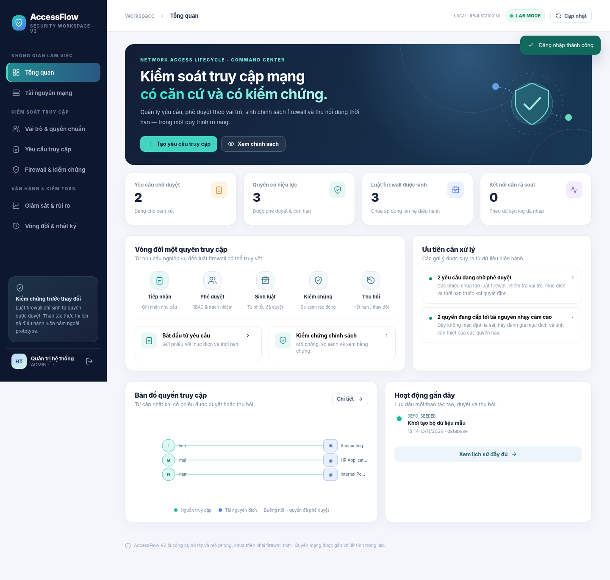

# AccessFlow V2 — Hệ thống mô phỏng tường lửa và quản lý truy cập mạng

**Tên đề tài:** Xây dựng chương trình mô phỏng tường lửa và kiểm soát truy cập mạng.

**AccessFlow V2** là ứng dụng web mô phỏng quá trình quản lý vòng đời quyền truy cập tài nguyên mạng trong một doanh nghiệp giả lập. Hệ thống hỗ trợ khai báo người dùng và tài nguyên, phân quyền theo vai trò, gửi và phê duyệt yêu cầu, sinh luật tường lửa theo quyền có hiệu lực, mô phỏng và kiểm toán chính sách, phân tích log, thu hồi quyền và xuất báo cáo.

> **Phạm vi:** AccessFlow V2 là nguyên mẫu chạy cục bộ. Các quyết định ALLOW/DENY trên giao diện là kết quả mô phỏng; ứng dụng **chưa tự động đẩy luật** sang Linux nftables hoặc thiết bị firewall thực tế. Phần thực nghiệm VMware được cấu hình và kiểm thử riêng.



## 1. Công nghệ sử dụng

| Thành phần | Công nghệ |
|---|---|
| Backend và REST API | Python, FastAPI |
| Giao diện | HTML, CSS, JavaScript |
| Cơ sở dữ liệu | SQLite |
| Máy chủ web cục bộ | Uvicorn |
| Phiên đăng nhập | Signed session cookie |
| Kiểm thử tự động | Python `unittest` |
| Thực nghiệm bổ sung | VMware Workstation, Ubuntu Server, Linux network namespaces, nftables |

Ứng dụng không yêu cầu Node.js, npm hoặc Streamlit.

## 2. Sáu nhóm chức năng

1. **Quản lý tài nguyên và danh tính:** quản lý người dùng, máy chủ, địa chỉ IP, dịch vụ và trạng thái tài nguyên.
2. **Vai trò và quyền truy cập chuẩn (RBAC):** phân biệt vai trò thao tác trong hệ thống (`ADMIN`, `APPROVER`, `EMPLOYEE`) và vai trò nghiệp vụ (`ACCOUNTING`, `HR`, `SALES`, `IT`). Quyền chuẩn cho phép **xin** truy cập, không trực tiếp tạo luật ALLOW.
3. **Yêu cầu và phê duyệt:** tạo phiếu có mục đích/thời hạn, duyệt hoặc từ chối, kiểm tra quyền của người duyệt và xem trước tác động thay đổi.
4. **Firewall và kiểm toán:** sinh luật từ quyền đã duyệt còn hiệu lực; mặc định `DENY`, mô phỏng `first-match`, giải thích dấu vết quyết định, so sánh chính sách, phát hiện phạm vi cấp quyền quá rộng/thiếu quyền và xuất JSON/bản nháp nftables cho lab.
5. **Giám sát và rủi ro:** nhập log CSV hoặc Zeek JSONL, loại bỏ bản ghi trùng và đối chiếu lưu lượng quan sát với quyền có hiệu lực để cảnh báo trường hợp cần rà soát.
6. **Vòng đời và nhật ký:** thu hồi quyền, xử lý hết hạn và thay đổi trạng thái, ghi nhật ký thao tác và xuất báo cáo Markdown/JSON.

Ứng dụng có thêm trang tổng quan về trạng thái và các chỉ số liên quan đến quyền truy cập.

## 3. Cài đặt và chạy trên Windows

**Yêu cầu:** Windows 10/11, Python 3.10 trở lên và trình duyệt web hiện đại. Cần Internet khi cài thư viện lần đầu.

Mở thư mục dự án trong VS Code, mở Terminal tại vị trí chứa `run.py` và `requirements.txt`, sau đó chạy:

```powershell
python -m pip install -r requirements.txt
python run.py
```

Mở trình duyệt tại **http://127.0.0.1:8000**.

Nếu cổng 8000 đã được sử dụng:

```powershell
python run.py --port 8001
```

Khi đó truy cập **http://127.0.0.1:8001**. Nhấn `Ctrl+C` trong Terminal để dừng ứng dụng.

Ngoài ra, có thể sử dụng `install_windows.bat` và `run_windows.bat` trên Windows.

### Tài khoản demo

Khi sử dụng cơ sở dữ liệu mới, chương trình tạo các tài khoản mẫu:

| Tài khoản | Vai trò hệ thống | Vai trò nghiệp vụ |
|---|---|---|
| `admin` | `ADMIN` | `IT` |
| `approver` | `APPROVER` | `IT` |
| `linh` | `EMPLOYEE` | `ACCOUNTING` |
| `mai` | `EMPLOYEE` | `HR` |
| `nam` | `EMPLOYEE` | `SALES` |
| `quang` | `EMPLOYEE` | `ACCOUNTING` |

Mật khẩu mẫu: `Demo@2026!`.

Các tài khoản chỉ dùng trong môi trường lab cục bộ, không dùng cho hệ thống công khai. Cơ sở dữ liệu phát sinh tại `runtime/access.sqlite3`; thư mục `runtime/` không cần đưa vào bản ZIP mã nguồn nộp.

## 4. Quy trình minh họa: cấp quyền truy cập CRM

1. Đăng nhập `admin`, tạo tài nguyên **CRM Lab** có IP `10.20.4.20` và khai báo dịch vụ TCP/443. Nếu dữ liệu đã có, không cần tạo trùng.
2. Tạo quyền chuẩn cho vai trò `SALES` được phép yêu cầu dịch vụ CRM.
3. Đăng nhập `nam`, gửi yêu cầu truy cập CRM với mục đích và thời hạn. Phiếu ở trạng thái `PENDING`, chưa sinh quyền ALLOW.
4. Đăng nhập `approver`, xem trước tác động và phê duyệt phiếu hợp lệ.
5. Trên phân hệ Firewall, kiểm tra luật được sinh cho kết nối `10.10.30.10 → 10.20.4.20`, giao thức TCP, cổng đích 443. Khi quyền có hiệu lực, mô phỏng trả về `ALLOW`; kết nối ngoài phạm vi quyền mặc định `DENY`.
6. Thu hồi phiếu đã cấp; nếu không còn quyền hợp lệ khác với cùng phạm vi, luật ALLOW tương ứng biến mất và kết nối mới được mô phỏng là `DENY`.

Quy trình mô phỏng trên web và phần thực nghiệm VMware là **hai hoạt động độc lập**, chưa có kết nối triển khai luật tự động giữa chúng.

## 5. Cấu trúc mã nguồn

```text
Firewall_Access_Lifecycle/
├── backend/
│   ├── __init__.py
│   ├── app.py              # Ứng dụng FastAPI và REST API
│   ├── auth.py
│   └── insights.py
├── core/
│   ├── __init__.py
│   ├── auditor.py
│   ├── database.py
│   ├── demo.py
│   ├── exporters.py
│   ├── monitoring.py
│   ├── policy.py
│   ├── reports.py
│   ├── security.py
│   └── workflow.py
├── docs/
│   ├── KIEN_TRUC_V2.md
│   ├── assets_crm_preview.png
│   ├── assets_preview.png
│   ├── dashboard_preview.png
│   ├── login_preview.png
│   └── policy_preview.png
├── samples/
│   ├── traffic.csv
│   ├── what_if_broad.json
│   └── zeek_conn.jsonl
├── tests/
│   ├── __init__.py
│   ├── test_api.py
│   └── test_system.py
├── web/                   # HTML/CSS/JavaScript giao diện
├── .gitignore
├── cli.py
├── install_windows.bat
├── README.md
├── requirements.txt
├── run_windows.bat
└── run.py
```

**Lưu ý về vị trí file:** `run.py` khởi động ứng dụng qua `backend.app:app`, vì vậy file FastAPI **phải nằm tại `backend/app.py`**, không phải `app.py` ở thư mục gốc. Thư mục `runtime/` được tạo khi chạy và không nằm trong mã nguồn phân phối.

Tài liệu kỹ thuật chi tiết: [`docs/KIEN_TRUC_V2.md`](docs/KIEN_TRUC_V2.md).

## 6. Kiểm thử tự động và CLI

Chạy toàn bộ bài kiểm thử:

```powershell
python -m unittest discover -s tests -v
```

**Kết quả kiểm thử trên mã nguồn V2:** 55 bài kiểm thử, **55/55 đạt**. Các bài kiểm thử bao phủ nghiệp vụ lõi và API.

Một số lệnh CLI hữu ích:

```powershell
python cli.py status
python cli.py policy
python cli.py audit
python cli.py compare samples/what_if_broad.json
```

## 7. Thực nghiệm kiểm chứng trên VMware

Một môi trường mạng ảo cách ly được xây dựng trên Ubuntu Server, gồm ba Linux network namespace kết nối qua các cặp giao diện `veth`:

| Namespace | Địa chỉ IP | Vai trò |
|---|---|---|
| `client` | `10.10.30.10` | Máy khách |
| `fwlab` | `10.10.30.1`, `10.20.4.1` | Chuyển tiếp và lọc lưu lượng bằng nftables |
| `crm-server` | `10.20.4.20` | Máy chủ dịch vụ thử nghiệm TCP/443 |

Trong lab, CRM chạy **HTTP thử nghiệm trên TCP/443** để kiểm tra kết nối, **không phải HTTPS có mã hóa**.

| Trạng thái thử nghiệm | Kết quả kết nối từ Client |
|---|---|
| Chưa áp dụng chính sách chặn | `HTTP/1.0 200 OK` |
| `DENY`: mặc định `DROP` | Hết thời gian chờ kết nối (`timeout`) |
| `ALLOW`: thêm luật cho Client → CRM TCP/443 | `HTTP/1.0 200 OK` |
| `REVOKE`: xóa luật ALLOW | Hết thời gian chờ kết nối (`timeout`) |

Thực nghiệm xác nhận tác động của chính sách nftables lên **kết nối TCP mới trong lab**. Các luật đã được áp dụng **thủ công** tại namespace `fwlab`; AccessFlow V2 chưa tự động đồng bộ chính sách web sang máy ảo.

## 8. Giới hạn kỹ thuật

- Mô hình chính sách sử dụng IPv4 stateless, IP nguồn/đích, giao thức và cổng đích; chưa mô phỏng đầy đủ NAT, IPv6, định tuyến và trạng thái kết nối.
- Ánh xạ tài khoản với IP chỉ là giả định trong lab, không phải xác thực danh tính thiết bị trên mạng thật.
- Kết luận kiểm toán chỉ áp dụng trong phạm vi mô hình hỗ trợ; khi vượt giới hạn phân hoạch có thể trả về `INCONCLUSIVE`.
- Kiểm toán so với quyền đã duyệt đánh giá tính nhất quán nội bộ, không chứng nhận hệ thống mạng thực tế an toàn.
- Việc phân tích log không đồng nghĩa xác nhận quyết định của firewall tại điểm thực thi.
- Chưa có kết nối tự động đến firewall thật, cơ chế rollback triển khai, SSO/MFA hoặc biện pháp hardening hoàn chỉnh cho production.

## 9. Hướng phát triển

- Xây dựng bộ kết nối triển khai chính sách có kiểm tra cú pháp, phê duyệt, xác thực thiết bị và rollback.
- Bổ sung nguồn nhận dạng thiết bị, lịch sử thay đổi IP và dữ liệu log từ điểm thực thi tin cậy.
- Mở rộng phạm vi điều kiện firewall được mô phỏng và cải thiện hiệu năng kiểm toán chính sách lớn.
- Hoàn thiện bảo mật ứng dụng và phân quyền cho môi trường triển khai thực tế.

## 10. Kết luận

AccessFlow V2 minh họa cách chuyển yêu cầu truy cập có phê duyệt thành các luật mạng có thể truy vết, mô phỏng và kiểm toán. Thực nghiệm nftables bổ sung xác nhận rằng một chính sách tương đương có thể cho phép hoặc chặn kết nối TCP trong môi trường mạng ảo cách ly. Hệ thống hiện là nguyên mẫu phục vụ học tập và nghiên cứu, chưa phải giải pháp firewall vận hành tự động.
